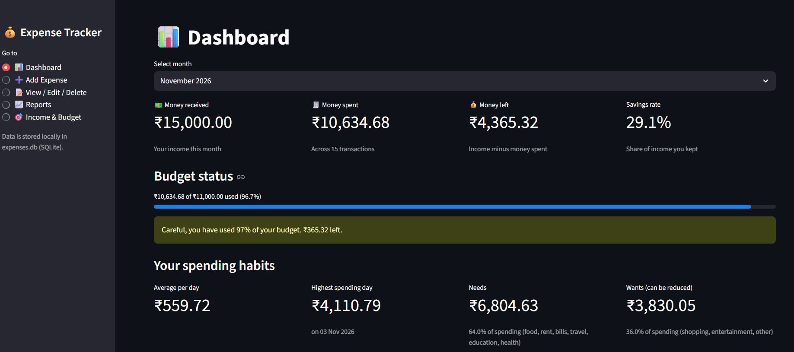
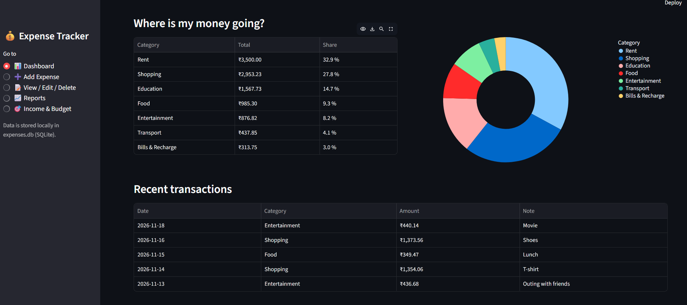
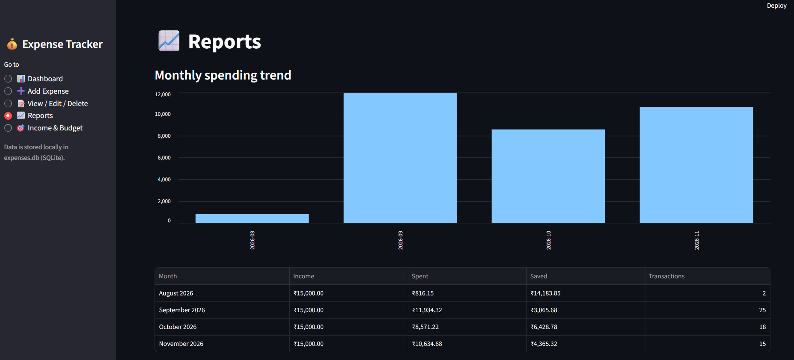

<h1 align="center">💰 Personal Expense Tracker</h1>

<p align="center">
  A simple web app that shows you <b>how much money you receive, where it goes, and how much is left.</b>
</p>

<p align="center">
  
  
  
  
</p>


## 📌 Table of Contents
- [Problem Statement](#-problem-statement)
- [What the App Answers](#-what-the-app-answers)
- [Features](#-features)
- [Screenshots](#-screenshots)
- [Tech Stack](#-tech-stack)
- [Project Structure](#-project-structure)
- [Getting Started](#-getting-started)
- [How to Use](#-how-to-use)
- [Database Design](#-database-design)
- [Design Decisions](#-design-decisions)
- [Limitations and Future Improvements](#-limitations-and-future-improvements)
- [Author](#-author)

---

## 🎯 Problem Statement
Many people spend money on food, travel, shopping, bills and other daily activities but do not keep proper records. As a result:

- They forget where their money was spent.
- They find it difficult to control unnecessary expenses.
- They cannot easily calculate their monthly savings.
- They lack a clear understanding of their spending habits.

This project solves these problems with a simple, easy-to-use web application.

## ❓ What the App Answers
| Question | Where you see it |
|---|---|
| **How much money am I receiving?** | 💵 *Money received* on the dashboard (your monthly income) |
| **Where is my money being spent?** | 📊 *Category table*, donut chart and recent transactions |
| **How much money do I have left?** | 💰 *Money left* (income minus spending) and your savings rate |

## ✨ Features
| Problem | Feature |
|---|---|
| Forgetting where money went | Add, view, search, edit and delete every expense with date, category and note |
| Controlling unnecessary spending | Monthly budget with a warning at 80% and an alert when you go over. A **Needs vs Wants** split shows what can be reduced |
| Calculating monthly savings | Enter monthly income; the app shows money left and savings rate |
| Understanding spending habits | Average spend per day, highest spending day, category breakdown, comparison with last month, monthly reports |

**More details**
- 📊 **Dashboard:** income, spent, money left, savings rate, budget progress, spending habits, category table and donut chart
- ➕ **Add Expense:** form with validation (amount must be above 0, date cannot be in the future)
- 📝 **View / Edit / Delete:** filter by category, search in notes, edit any entry, delete with a confirmation tick
- 📈 **Reports:** monthly spending trend, month-wise income / spent / saved table, all-time category chart, **CSV download**
- 🎯 **Income & Budget:** set income and a spending limit for any month

## 📸 Screenshots
**Dashboard: money received, spent, left, budget status and spending habits**



**Where is my money going? Category breakdown and recent transactions**



**Reports: monthly trend and month-wise savings**



## 💻 Tech Stack
| Tool | Used for |
|---|---|
| **Python** | Application logic |
| **Streamlit** | Web user interface |
| **SQLite** (`sqlite3`) | Local database, no server needed |
| **Pandas** | Data handling and totals |
| **Altair** | Charts (donut and bar charts) |

## 📁 Project Structure
```
Personal-Expense-Tracker/
├── app.py              # Streamlit user interface (all pages)
├── database.py         # All SQLite queries (tables, CRUD, totals, income, budget)
├── seed_data.py        # Adds about 60 sample expenses for testing
├── requirements.txt    # Python libraries needed
├── screenshots/        # Images used in this README
└── README.md
```
The database code and the UI code are kept in **separate files**, so the app is easy to read and change.

## 🚀 Getting Started

**1. Clone the repository**
```bash
git clone https://github.com/alok-kumar06/Personal-Expense-Tracker.git
cd Personal-Expense-Tracker
```

**2. Install the libraries**
```bash
pip install -r requirements.txt
```

**3. (Optional) Add sample data to explore the app quickly**
```bash
python seed_data.py
```

**4. Run the app**
```bash
streamlit run app.py
```
The app opens in your browser at `http://localhost:8501`.

> If `streamlit` is not recognised, use `python -m streamlit run app.py`.

## 📖 How to Use
1. Open **Income & Budget** and enter your income (and optionally a spending limit) for the month.
2. Go to **Add Expense** and record each expense as it happens.
3. Open the **Dashboard** to see money received, spent and left, and where your money is going.
4. Use **Reports** to compare months and download your data as CSV.

> Starting fresh? Delete the `expenses.db` file to remove sample data.

## 💾 Database Design
The app uses three SQLite tables:

```sql
expenses (id INTEGER PRIMARY KEY, date TEXT, category TEXT, amount REAL CHECK (amount > 0), note TEXT)
income   (month TEXT PRIMARY KEY, amount REAL CHECK (amount > 0))   -- month as YYYY-MM
budget   (month TEXT PRIMARY KEY, amount REAL CHECK (amount > 0))   -- month as YYYY-MM
```
- All queries use **parameterised statements** (`?` placeholders) to prevent SQL injection.
- `CHECK` constraints stop invalid amounts at the database level, in addition to form validation.
- Income and budget use `UPSERT` (`INSERT ... ON CONFLICT DO UPDATE`), so saving twice for a month simply updates it.

## 🧠 Design Decisions
- **Needs vs Wants:** Food, Transport, Rent, Bills & Recharge, Education and Health are treated as *Needs*. Shopping, Entertainment and Other are treated as *Wants*. This simple rule highlights spending that can be reduced.
- **Average per day:** for the current month, total spent is divided by the days passed so far, not the full month.
- **Money left** is shown as a negative value, with a red alert, if spending is more than income.

## 🔮 Limitations and Future Improvements
- [ ] Single user, no login (add user accounts)
- [ ] Needs / Wants is decided by category, not by each purchase
- [ ] One income figure per month (support multiple income sources)
- [ ] Recurring expenses (rent, subscriptions)
- [ ] Savings goals and Excel export
- [ ] Cloud database and online deployment

## 👤 Author
**Alok Kumar**
B.Tech Computer Science & Engineering (Data Science)

[](https://www.linkedin.com/in/alok-kumar-91b0a829b/)
[](https://github.com/alok-kumar06)

---
<p align="center">If you found this project useful, give it a ⭐</p>
